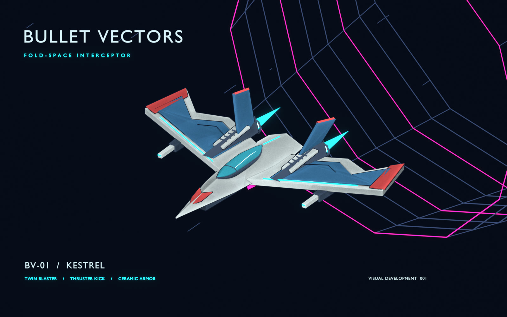

# Bullet Vectors

**Fly the storm. Seal the lanes. Fold space.**

A cel-shaded space shooter alternating between free-moving vertical bullet hell
and polygonal tube combat. Reach a warp gate, destroy lane gems, and seal every
lane before folding into the next dimension. The creatures inside the fold
fight harder as their routes disappear.



## Current milestone — 0.0.1 / visual foundation

- Original BV-01 Kestrel fighter, built in Blender through the connected MCP.
- Editable separated armor, canopy, engines, guns, thruster ports and mount markers.
- Compact fighter-style glass canopy with a flat crown and noseward-sloping windscreen.
- Stepped toon materials, ink silhouettes, cyan ion exhaust, polygon gate backdrop.
- Eight-second Blender turntable animation, frames 1–241 at 30 fps.
- Portable, ship-only glTF binary for subsequent game integration.
- Game rules, proposed controls, art direction and implementation roadmap.

**This is an art and design foundation, not a playable combat build.**

## View the ship

Open `art/blender/BV01_Kestrel.blend` in Blender 5.3. The active scene is
`BV_Kestrel_Lookdev`. Camera view shows the presentation; Space plays the turntable.
The original startup scene is preserved separately. Select the flight assembly
in the Outliner to inspect individual parts. The rendered preview is in
`art/renders/`; the engine-neutral model is `assets/ships/bv01_kestrel.glb`.

[Watch the five-second turntable preview](art/renders/kestrel_turntable.mp4).
[Inspect the canopy close-up](art/renders/kestrel_canopy_detail.jpg).

To rebuild from source in Blender's Python Console:

```python
from pathlib import Path
p = Path(bpy.data.filepath).with_name('build_kestrel.py')
exec(compile(p.read_text(encoding='utf-8'), str(p), 'exec'), {'__file__': str(p)})
```

The builder creates a new scene and does not delete existing scenes. Rebuilding
repeatedly adds another generated scene; use a fresh file for a clean rebuild.

## Project layout

| Path | Purpose |
| --- | --- |
| `art/blender/` | Editable scene and reproducible builder/render scripts |
| `art/renders/` | Review images and turntable preview |
| `assets/ships/` | Engine-neutral ship export and asset contract |
| `docs/GAME_DESIGN.md` | Core loop, weapons, enemies, gate rules, controls |
| `docs/ROADMAP.md` | Small, testable steps toward the first playable build |
| `docs/ART_DIRECTION.md` | Readability, palette and effects principles |

## Engine direction

Proposed: **Godot 4 with 3D cel-shaded meshes and constrained arcade movement**.
The vertical stage can use an orthographic camera; the gate can use a perspective
camera over the same player/weapon state. This avoids maintaining two unrelated
games or swapping the ship for a different representation. Engine selection is
provisional; no engine dependency is needed to review this milestone.

## Repository status

Development starts on `main` at
`https://github.com/docjaxx/Bullet-Vectors`. Preserve remote history when
continuing work: fetch first, inspect and merge deliberately; never force-push
over existing changes.

No license has been selected. Reference titles and artists describe influences;
the ship mesh, geometry, identifiers and presentation are original project work.
